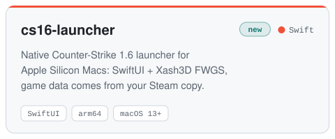
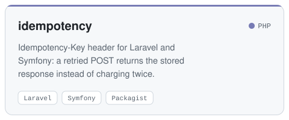
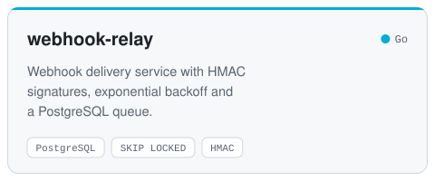
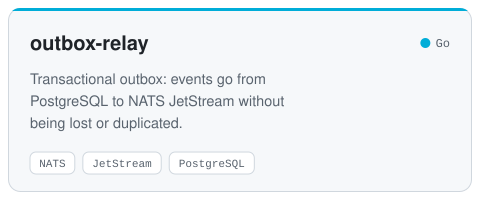
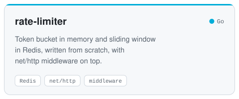
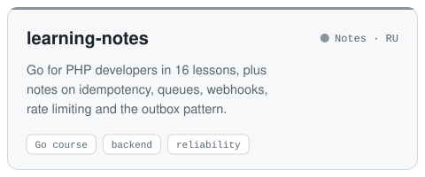
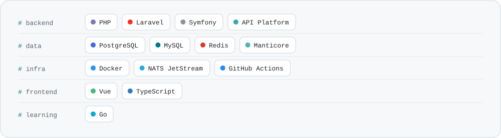

<picture><source media="(prefers-color-scheme: dark)" srcset="assets/header-dark.svg"></picture>

I build APIs in PHP with Laravel and Symfony and care most about the parts that break in production: retries, race conditions, data consistency. Lately I'm writing Go as well, and sometimes Swift for fun.

### Projects

<a href="https://github.com/kasevvlad/cs16-launcher"><picture><source media="(prefers-color-scheme: dark)" srcset="assets/card-cs16-launcher-dark.svg"></picture></a><a href="https://github.com/kasevvlad/idempotency"><picture><source media="(prefers-color-scheme: dark)" srcset="assets/card-idempotency-dark.svg"></picture></a>
<a href="https://github.com/kasevvlad/webhook-relay"><picture><source media="(prefers-color-scheme: dark)" srcset="assets/card-webhook-relay-dark.svg"></picture></a><a href="https://github.com/kasevvlad/outbox-relay"><picture><source media="(prefers-color-scheme: dark)" srcset="assets/card-outbox-relay-dark.svg"></picture></a>
<a href="https://github.com/kasevvlad/rate-limiter"><picture><source media="(prefers-color-scheme: dark)" srcset="assets/card-rate-limiter-dark.svg"></picture></a><a href="https://github.com/kasevvlad/learning-notes"><picture><source media="(prefers-color-scheme: dark)" srcset="assets/card-learning-notes-dark.svg"></picture></a>

### Stack

<picture><source media="(prefers-color-scheme: dark)" srcset="assets/stack-dark.svg"></picture>

### What I'm into

- Domain-driven design and clear boundaries inside PHP applications
- Reliable APIs: idempotency, queues, the outbox pattern
- Go for small, fast services

### Contact

[vladkasev13@gmail.com](mailto:vladkasev13@gmail.com)
